# Allgemein

## Was sind Rechnernetze

Ein Rechnernetz ist ein Zusammenschluss mehrer Computer und anderer Digitaler Geräte, um Daten auszutauschen und Ressourcen gemeinsam zu nutzen.

Die Hauptziele eines Rechnernetzes:

- Kommunikation zwischen Geräten
- Austausch von Daten und Information
- gemeinsame Nutzung von Ressourcen
- Effizienzsteigerung durch optimierte Prozesse und Zusammenarbeit

## Bestandteile eines Rechnernetzes

Die Bestandteile eines Rechnernetzes lassen sich in drei grundlegende Kategorien unterteilen: **Hardware**, **Software** und **Protokolle**.

### Hardware

- Netzwerkendgeräte (Hosts, Clients, Knoten)
- Infrastrukturkomponenten
  - OSI-Layer 1: Hubs
  - OSI-Layer 2: Switches, Access Points, Modems
  - OSI-Layer 3: Router
  - OSI-Layer 4: Gateways und Firewalls
- Übertragungsmedien (physische Verbindungen: Kabel und Kabellose Varianten)
  - Twisted-Pair-Kabel
  - Glasfaserkabel
- Softwarekomponenten (Steuerung und Verwaltung der Hardware)
  - Betriebssysteme (Client und Server)
  - Netzwerkdienste und -anwendungen
    - Dateiserver
    - Webserver
    - E-Mail-Server
    - DNS- und DHCP-Server
    - VoIP-Software
- Protokolle

# OSI-Layer

|Layer|Name|Protokolle|Geräte|
|-|-|-|-|
|1|Bitübertragungsschicht|USB, DSL, ISDN|Kabel, Hubs, Transciever|
|2||ARP, Ethernet, LLDP|Switches, Access Point, Modem|
|3||IP, RIP, OSPF, ICMP|Router
|4||TCP, UDP, TFTP|Gateway, Firewalls

## Netzwerkbereiche

### Geographischer Bereich (S. 7)

Beschreibt die Räumliche Audbreitung

- Personal Area Network (PAN): bis 10m, verbindet Geräte ohne Rounter oder Internetzugang. 1 - 10 Geräte
- Storage Area Network (SAN): Spezialisiertes Netzwerk, das Speichergeräte wie Festplatten oder Tape-Liberies mit Servern verbindet. Typische Technologien sind Fibre Channel (FC) oder Internet Small Computer System interface (iSCSI). 10 - 100 Systeme
- Local Area Network (LAN): kleiner geographischer Bereich, wie ein Gebäude oder ein Campus. 10 - 1000 Geräte
- Metropolitan Area Network (MAN): ein großflächiges Netzwerk, das sich über Länder oder Kontinente spannt. Tausende bis MIllionen von Geräten
- Global Area Network (GAN): ein Weltumspannendes Netz, dass mehrere WANs verbindet. Millionen von Geräte

### Topologie (S. 8)

Die physische oder Logische Struktur

#### Punkt-zu-Punkt

Zwei Systeme sind direkt verbunden, kein Routing nötig, kaum Skalierung.

#### Stern

Verbindet alle Systeme direkt mit einer zentralen aktiven Komponenten. Gute Erweiterbarkeit und einfaches Routing. Bei ausfall der mittleren Komponente ist das System down.

#### Ring

Alle Systeme sind RIngförmig miteinander verbunden. Sie können das Signal alle verstärken, doch wenn ein System ausfällt bricht die Verbindung ab. Außerdem kann immer nur ein Teilnehmer gleichzeitig senden.

#### Bus

Alle Systeme werden über einen zentralen Bus verbunden. Wenn dieser kaputgeht, bricht die Verbrindung ab. Dafür einfache Verkabelung.

#### Baum

hirachische Weiterwntwicklung des Sterns, einfache Erweiterbarkeit und übersichtliches Routing. Nur Hirachisch geringere Knoten und verbindungen sind nur von Ausfällen eines Knoten betroffen.
-
#### (Voll-)Vermascht

Jedes Gerät ist mit mehreren anderen Verbunden. So haben Ausfälle kaum auswirkungen, dafür ist es schwierig zu warten und kostet viel Kabel.

### Technologien

Eingesetzte Medien oder Protokolle

### Administrative Verantwortung

- Zentrale Verantwortung
- Verteilte Verwaltung

### Architekturen

#### Monolithische Anwendungssysteme

- Zentraler Großrechner, an den mehrere Terminals angesschlossen sind
- schlechte erweiterbarkeit und einbindung

#### Cloud-Computing

- Verteilt Anwendung und Ressourcen
- Servicemodelle
  - SaaS: Fertige Softwarelösung
  - IaaS: RAM/VRAM
  - PaaS: Entwicklungsplattformen für eigene Anwendungen
  - Public Cloud
  - Private Cloud
  - Hybrid Cloud

# Herausforderungen

## Verzögerung

### Verarbeitungsverzögerung

- Zeit, die ein Router benötigt, um zu empfangen, zu analysieren und weiterzuleiten
- Eintreffrate: $\alpha$ (Pakete pro Sekunde)
- Übertragungsgeschwindigkeit des Mediums $R$
- Bits pro Paket: $L$ und mittlere Bitmenge pro Paket $L_\alpha$

|$L / R$ (Verkehrswert)|Verzögerung|
|-|-|
|>1|gering|
|>1 && ~1|stark|
|<1|endlos|

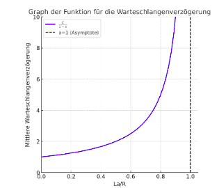

### Warteschlangenverzögerung

- wenn mehrere Pakete zeitgleich beim Router ankommen und in eine Warteschlange gestellt werden müssen.
- ein Router kann nur sequenziell weiterleiten

### Übertragungsverzögerung

- Zeit, die benötigt wird, ein Paket vollständig auf das Medium übertragen (Also das reine Senden?)
- $\text{Ausbreitungsgeschwindigkeit} = \frac{\text{Paketgröße}}{\text{Datenrate}}$

### Ausbreitungsverzögerung

- Die Zeit, die ein Signal vom Sender zu Empfänger braucht
- $\text{Ausbreitungsgeschwindigkeit} = \frac{Strecke}{Ausbreitungsgeschwindigkeit}$

## Durchsatz

- momentan: Geschwindigkeit, mit der der Host empfängt
- durchschnittlich: $R = \frac{\text{Datenmenge F}}{t}$
- maximale Durchsatzrate: $R = \min(\text{R_S Geschwindigkeit der Datenübertragung des Servers}, \text{R_C Geschwindigkeit der Datenübertragung des Clients})$
  - Wenn $R_S > R_C$, entstehen Engpässe

## Skalierbarkeit

Skalierbarkeit beschreibt die Fähigkeit selbst bei zunehmender Größe stabil und leistungsfähig zu bleiben.

### Horizontale Skalierung

- Erweiterung um physische Komponenten
- Erhöhung der Fehlertoleranz
- Ermöglichen von Rolling Updates

### vertikale Skalierung

- Bestehende Komponenten leistungsfähiger machen
- stößt schneller an physikalische oder wirtschaftliche Komponenten

## Verfügbarkeit

Beschreibt die Betriebsbereitschaft eines Netzwerks.

### Redundanz

- multible Verkabelung

### Failover-Mechanismen

- Automatisches Umschalten auf Ersatzsysteme

### Fehlertolerante Protokolle

### Monitoring und Frühwarnsysteme

- Bestimmte Protokolle und Tests wie Pings sind oft Frühwarnungen

## Sicherheit und Datenschutz (CIA)

### Vertraulichkeit (Confidential)

Nur berechtigte Personen dürfen auf Informationen zugreifen.

### Integrität (Integrity)

Daten dürfen nicht unbemerkt manipuliert/beschädigt werden.

### Verfügbarkeit (Availability)

Systeme und Daten müssen zuverlässig nutzbar sein

### Wege dorthin

- Zugriffs- und Rechteverwaltung: Rollenbasierte Zugriffskonzepte
- Verschlüsselung der Daten: Technologien wie HTTPS oder TLS
- Firewall-, Intrusion Detection/Prevention Systeme (IDS/IPS): Kontrollieren des Datenverkehrs und erkennen von verdächtigen Mustern
- Physische Sicherheit der Netzwerk-Komponten.

# ISO/OSI-Modell

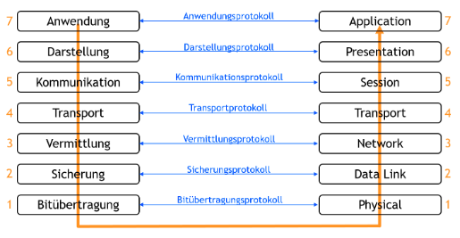

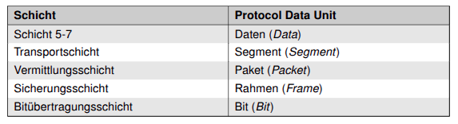

## Ein- und Entkapselung

Jede Schicht fügt einen Header mit für die Schicht relevanten Metadaten hinzu. Bei der Entkapselung werden die Header von ihren Schichten wieder entfernt.

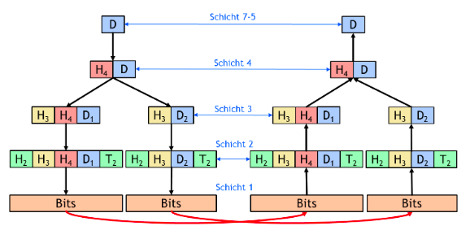

## Bitübertragungsschicht

- Physikalische Übertragung der Bitfolgen
- Wandelt die Bits basieren auf den Anforderungen der Übertragungsinfrastruktur um
  - Kupfer: Elektrisches Signal
  - Glasfaser: optisches Signal
  - drahtlos: Funk- oder Lichtwellen
- definiert Bitlaufzeiten und Aufbau, Erhalt und Rücksetzbarkeit der physikalischen Verbindung
- keine Fehlerprüfung, lediglich Übertragung

## Sicherungsschicht

- sorgt für die fehlerfreie Datenübertragung innerhalb von lokalen Netzwerken.
- physikalische (MAC-)Adressen für die Identifikation

### Media Access Control (MAC)

Steuert den Zugriff auf das Übertragungsmedium und regelt, welches Gerät wann senden darf.

### Logical Link Control (LLC)

- Erkennt und behebt Übertragungsdehler
- verwaltet logische Verbindungen und Gruppiert Bits in Frames

## Vermittlungsschicht

- logische Addressierung und Routing zwischen Netzwerken
- IP-Adressen

### Routing

- **Statisches Routing**: Vordefinierte Routen, unabhängig der aktuellen Netzwerksituation
- **Dynamisches Routing**: Routen werden für jede Übertragung neu bestimmt - je anch Auslastung, Verzögerung und Verbindungsstatus

### MTU (Maximum Transmission Unit)

- Maximale Größe von IP-Paketen
- Wenn Überschritten, dann Fragmentiert

### Übertragung über Router

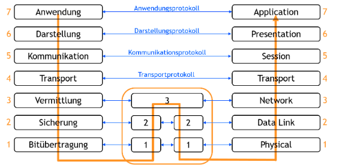

## Transportschicht

- Zuverlässige Ende-zu-Ende-Kommunikation

### TCP (Transmission Control Protocol)

- verbindungorientiert
- gewährleistet zuverlässige Datenübertragung
  - Prüfsummen
  - Pakete in der richtigen Reihenfolge zusammensetzt
  - verlorene Datenpakete erneut Anfordert

### UDP (User Datagram Protocol)

- verbindungslos
- keine Fehlerkontrollen
  - dadurch schneller
- Anweendung, wenn Integrität weniger wichtig als geringe Verzögerung

### ICMP (Internet Control Message Protocol)

- Fehlermeldung/-diagnose
- Hosterreichbarkeit (PING)

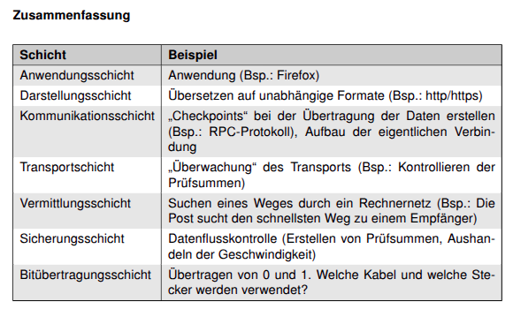

# TCP/IP-Modell

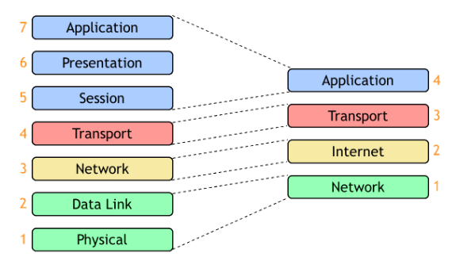

# Bitübertragungsschicht

## Kenngrößen

### Bandbreite (B)

- Differenz der unteren und oberen Grenzfrequenz
- Hz (Hertz)

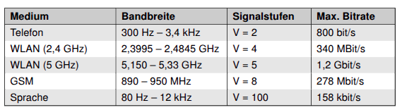

### Datenübertragungrate (R)

- Wie viele digitale Informationen pro Zeit
- $R=\frac{\text{Datenmenge D}}{t}$

### Baudrate

- Anzahl der Symbole pro Zeit
- Ein Symbol kann aus mehreren Bit bestehen
- Nyquist-Shannon-Abtasttheorem ($R \geq 2B$)

# Codierungen

## Non Return To Zero (NRZ)-Codes

### NRZ-L (Level)

- 1 durch einen Hohen Pegel, 0 durch einen niederen
- nicht selbsttaktend

### NRZ-I (Inverted)

- 1 durch einen niederen Pegel, 0 durch einen Hohen
- nicht selbsttaktend

### NRZ-M (Mark)

- Pegelwechsel bei einer 1
- nicht selbsttaktend

### NRZ-S (Space)

- Pegelwechsel bei einer 0
- nicht selbsttaktend

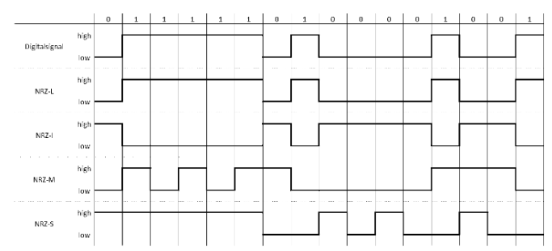

## Return to Zero (RZ-)Codes

- Nutzen drei Zustände: -1; 0; 1
- erleichtert Synchronisation auf kosten Höherer Bandbreite
- Logische Null: -1

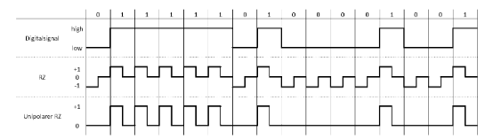

## Multilevel Transmission Encoding - 3 levels (MLT-3)

- 3 Spannungsniveaus (-1, 0, +1)
- Änderung immer bei 1 (Reihenfolge: 0, 1, 0, -1, 0)
- Halbe Beindbreite gegen NRZ
- nicht selbsttaktend

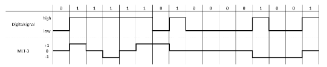

## Manchester-Code

- Selbsttaktend
- Eine 0 wird durch den Wechsel von High to Low dargestellt
- Eine 1 durch den Wechsel von Low to High

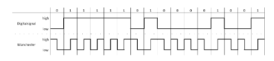

# Modulation

- Anpassen der Frequenz der Nutzdaten in den Durchlassbereich der Übertragung

## Analoge verfahren

- Amplituden-Modulation (AM)
- Frequenz-Modulation (FM)
- Phasen-Modulation (PM)

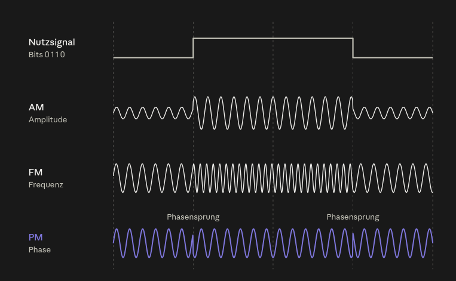

## Digitale Modulation

- Amplitude Shift Keying (ASK): Unterschiedliche Amplituden codieren Bitwerte
- Frequency Shift Keying (FSK): Unterschiedliche Frequenzen codieren Bitwerte
- Phase Shift Keying (PSK): Die Phase eines Trägersignals springt zwischen festen Werten
  - 0° und 180°: BPSK
  - 0°, 90°, 180°, 270°: QPSK
- Quadrature Amplitude Modulation (QAM): Kombination aus AM und PM, kann mehrere Bits pro Symbole Übertragen

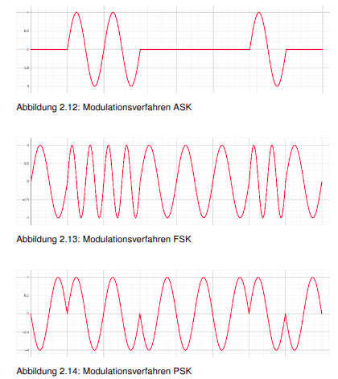

## Mehrträgermodulation

- Signal wird auf viele benachbarte Frequenzen verteilt, um die Daten paralell zu übertragen

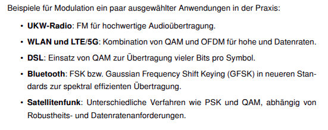

# Konstallationsdiagramme (I/Q-Diagramme)

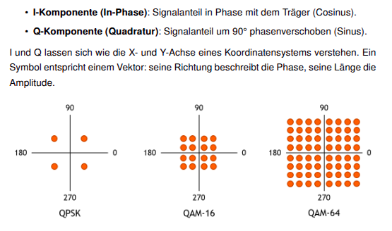

Eine höhere Informationsdichte macht die Übertragung Anfälliger gegenüber Rauschen

## Gray-Code

Repositionierung der Symbole, so dass benachbarte Symbole sich nur in einem Bit unterscheiden, was Mehrbitfehler unwahrscheinlicher macht

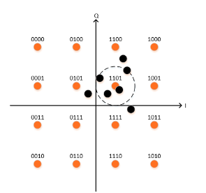

# Multiplexing

Mehr Daten durch eine Datenleitung senden.

## Trennung

### Frequency Division Multiplexing (FDM)

- Aufteilen der Bandbreite in unterkanäle: Paralelle Übertragung.
- Schutzfrequenzen gegen Überlappung
- OFDM: Keine Überlappung aufgrund Orthogonaler Auteilung nötig.

### Time Division Multiplexing (TDM)

- Jeder Teilnehmer erhält feste Zeitschlitze zum Übertragen
- Synchrones TDM: fest auch wenn ungenutzt
- Asynchrones/statistisches TDM: Zeitschlitze werden bei Bedarf vergeben.

### Code Division Multiplexing (CDM)

- orthogolane Chip-Codes, die orthogonal sind
- Jeder Teilnehmer multipliziert seine Daten mit dem Chip-Code
- Alle senden gleichzeitig. Der Empfänger multipliziert das Signal mit der Chipfolge und summiert die Chips auf
  - -N, eine Null übertragen
  - N, eine Eins übertragen
  - 0, nichts übertragen

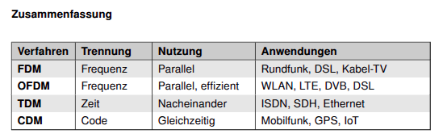

# Kabelgebundene Übertragung

## Thin-Wire (Koaxial-Kabel)

- Bus-Topologie
- Geringe Übertragungsrate

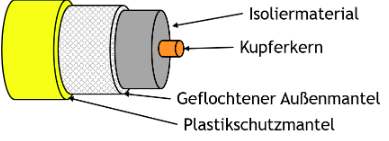

## Twisted Pair

- verdrillte Adernpaare

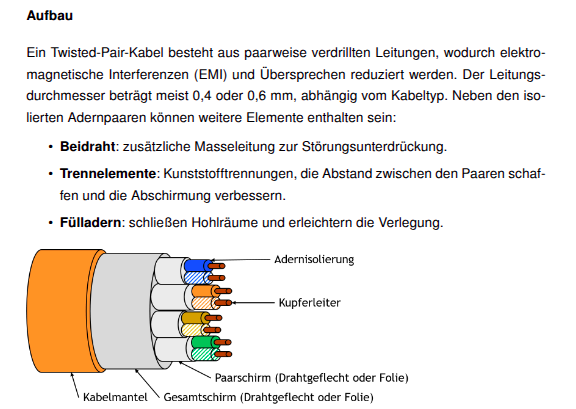

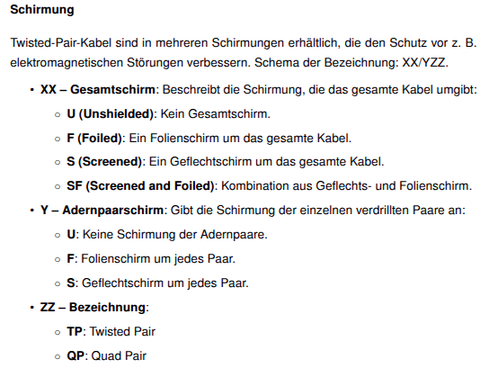

## Glasfaserkabel

- Totalreflexion von Licht

### Multimode

- vielfache reflexion

### Single-Mode

- besonders dünner kern, wodurch es ein Wellenleiter wird
- ohne reflexion geleitet

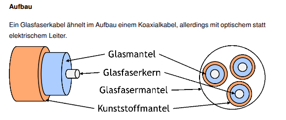

### Fasertypen

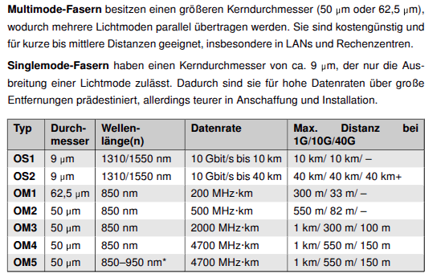

# Strukturierte Verkabelung

## Verkabelungsebenen

### Primär (Geländeverkabelung)

- Hauptanbindung eines Gebäudes an ein Rechenzentrum oder an den Gebäudeverteiler
- Hohe Reichweite nötig

### Sekundär

- Gebäudeverteiler an Etagenverteiler

### Tertiär (Etagenverkabelung)

- Etagenverteiler zu den Endgeräten

### Vorteile

- Hirachische Struktur
  - einfaches Eingrenzen auf Etage/Gebäude/Gesamtnetz
- Skalierbarkeit
- Kosten- und Leistungseffizienz

## Netzwerkdesign

### Collapsed Backbone

- Verzichted auf sekundäre Verkabelung
- Weniger Platz und Verwaltungsaufwand
- Sigle Point of Failure

### Distributed Backbone

- Weitere Aufteilung

# Kabellose Übertragung

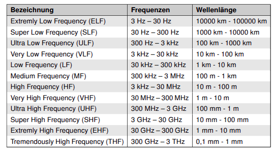

## Spreizspektrumverfahren

### Frequency Hopping Spread Spectrum (FHSS)

- Einteiled der Bandbreite in kleinere Kanäle
- per Pseudozufallsverfahren wird zwischen verschiedenen Kanälen gesprungen
- erschwerte Abhörung und bessere Ausfallsicherheit

### Direct Sequence Spread Spectrum (DSSS)

- multiplizieren mit einer Schnellen Chipfolge
- erhöhte ABhörsicherheit und Störunanfällig

### Ultra-WideBand (UWB)

- min 500mHz Banbreite
- sehr geringe Leistung nötig, dadurch sehr hohe Datenrate möglich

# Hubs

- keine Kollisionsvermeidung
- einfaches ungefiltertes weiterleiten

# Sicherungsschicht

## Aufbau und Aufgaben

- Fehlerfreie Übertragung Datenübertragung zwischen direkt verbundenen Netzwerkknoten
- Fehlererkennung und -korrektur
  - Prüfsummen
  - zyklische Redundanzprüfung (CRC)
- regulierung des Verkehrs, um Überlastung zu vermeiden
- Kapselung in Frames
  - Header: Steuerinformationen
  - Nutzdatenfeld
  - Trailer: Prüfsummen

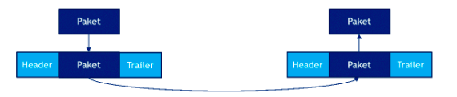

## Übertragungsarten

### Unbestätigter verbindungsloser Dienst

- unabhängige Rahmen
- keine Bestätigung für erhalt
- Genutzt, wenn Übertragung sicher oder vollständigkeit nicht wichtig, wie in Sprachchats

### Bestätigter verbindungsloser Dienst

- keine dauerhafte logische Verbindung
- bestätigung des Empfangs jedes einzelnen Rahmens
- Wenn nicht in bestimter Zeit erhalten, wird erneut gesendet
- Bei unzuverlässigen Übertragungsmedien eingesetzt

### Bestätigter verbindungsorientierter Dienst

- logische Verbindung
- nummerierung der Frames
- Jedes Eintreffen wird rückgemeldet
- Jeder Frame wird genau einmal übertragen
- Die Reihenfolge wird beibehalten
- Wenn Daaten unbedingt Fehlerfrei sein müssen

## Rahmenbildung

### Bytezahl

- Header enthält anzahl der Bytes, so dass der Empfänger weiß, wo ein Rahmen endet.
- Sehr Fehleranfällig, darum kaum noch isolierte Verwendung

### Flagbytes

- Jeder Rahmen beginnt und endet mit besonderen Flagbytes
- Wenn das Flagbyte in den Nutzdaten ist, wird ein Escapebyte (Bytestopfen) davorgesetzt, wenn ein Escape-Byte enthalten ist, wird dieses erneut escapet.

### Codierungsverletzungen

- Nutzung von Codierungsfehlern
  - 4B/5B: 5 Bit nutzen, um 4 Bit darzustelleN: 16 "Fehlerhafte" Kombnationen, die als Begrenzung genutzt werden können.

## Fehlerüberwachung

### Paritätsprüfung

Ein zusätzliches Biteigt, ob gerade oder ungerade Anzahl Bits

### Prüfsumme

### Zyklische Redundanzprüfung (CRC)

## Fehlerkorrektur

- Bestätigung des korrekten Empfangens: Acknowledgment (ACK)
- Melden der Fehlerhaften Übertragung: Negative Acknowledgment (NAK)
- Zum Abfangen einer Verlorengegangenen Bestätigung wird ein Timer genutzt
  - Sollte dieser Auslaufen, ohne dass ein ACK oder NAK gesendet wurde, wird der Rahmen als verloren angenommen und erneut gesendet
  - Um so entstehende Dopplungen zu umgehen werden Sequenznummern
    - So erkennt der Empfänger, wenn ein Rahmen Doppelt eintrifft und kann ihn verwerfen

### Wiederholungsstrategien

- **Go-Back-N-ARQ**: Mehrere Rahmen auf einmal, wenn eines verloren oder kaputt: alle folgenden erneut
- **Selective Repeat ARQ**: Nur fehlerhafte Rahmen werden erneut gesendet

- Flusskontrolle: Der Empfänger schickt regelmäßig infos über den Puffer, damit der Sender ihn nicht überfordert

### Paritätsprüfung

- Gerade Anzahl Bits: 0
- Ungerade Anzahl Bits: 1

### Paritätsschema

- 2D-Schema
- Daten werden auf zwei Achsen geteilt, um das gekippte Bit zu identifizieren

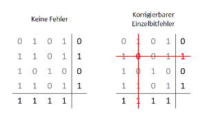

### Prüfsumme

- Alle Datenblöcke werden addiert und ergeben eine Summe, welche an die Nachricht angehangen wird.
- Der Empfänger tut dies gleich und addiert die Prüfsumme dazu und kommt so auf eine einer-kette, wenn korrekt.

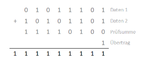

### Cyclic Redundancy Check (CRC)

- Generatorpolynom k
- Bitfolgen als Binärpolynom

#### Ablauf

- An Datenpaket k Nullbits anhängen
- Gesamtpaket per XOR mit Generatorpolynom dividieren
- Ergebnis wird an den Empfänger geschickt
- Dieser wendet wieder XOR mit dem Generatorpolynom an
  - Wenn 0 herauskommt wurde korrekt übertragen

#### Fehler

- Wenn das Generatorpolynom fehlerhaft Übertragen wurde, kann ein false-positiv bei der Fehlerprüfung auftreten
- In seltenen Fällen kann die Division auch bei Fehlern noch 0 ergeben.

## MAC-Adressen

- MAC: Media Access Controll
- Addressierung auf OSI-Layer 2

## Mehrfachzugriffsprotokolle

### ALOHA

- Alle Sender schicken Zeitgleich an einen Empfänger
- Bei gleichzeitigem Senden gehen alle Pakete kaputt
- Sofern das passiert antwortet der EMpfänger und die Sender senden nach einer zufälligen Zeit erneut

### Slotted ALOHA

- Es werden Zeitscheiben eingeführt
- Sender müssen nun auf den Beginn einer Zeitscheibe warten und bei Kollision wird eine Zufällige Anzahl Zeitscheiben gewartet

### CSMA-Protokolle

- Geräte fragen den Kanal vor dem Senden ab, ob gerade jemand sendet

#### Persistentes CSMA

- kontinuierlicihe Überwachung des Mediums vor dem senden
- bei kollision zufällige Zeitspanne warten

#### nicht-persistentes CSMA

- prüft einmal pro Zeitinterval

#### p-persistentes CSMA

- Test des Kanals
  - Frei: Sendet mit Wahrscheinlichkeit p
  - Besetzt: wartet mit Wahrscheinlichkeit q = 1 - p auf die nächste Zeitscheibe

#### CSMA/CD

##### Ablauf

1. Carrier Sense - Abhören des Mediums
  - Kontinuierliches Prüfen (Busy Waiting)
  - Wenn frei wird wartet das System (Interframe Gap)
  - Während des Sendens hört er weiter ab, um Kollision frühzeitig zu erkennen (Listen while Talk)
2. Sendevorgang
  - Übertragung beginnt mit einer Präambel
3. Kollisionserkennung
  - Bei Erkennen einer Kollision wird ein FAM-Signal gesendet (32 Bit)
  - Wird dieses Empfangen unterbrechen alle Stationen ihr Senden.
4. Übertragungswiederholung
  - nach einer Zufälligen Zeit fangen sie wieder das Abhören an.
  - nach 16 Erfolglosen Übertragungsversuchen, bricht der Vorgang ab (Attempt Limit)

## Kollisionsfreie Protokolle

### Bitmusterprotokoll (Reservierungsprotokoll)

- Kollisionslos
- N Zeitscheiben (N = Anzahl der Geräte)
- jedes System genau eine Zeitscheibe
- Wenn sie Übertragen möchte sendet sie während ihrer Scheibe eine 1
- Am ende dieser Konkurenzperiode weiß jeder, wer senden mag
- Dann senden alle Stationen in der Reihenfolge der Zeitscheiben

### Tokenweitergabe

- kollisionsfrei
- bestimmtes Steuerpaket „Token”
- Nur die Station mit diesem Token darf senden.
- Nach erfolgter Sendung wird es weitergegeben

### Binärer Countdown

- kollisionsfrei
- geringerer Overhead
- MAC-Adressen werden an jeden Geschickt
  - Wenn eine Stelle der anderen eine 1 hat, wo die eigene eine Null hat, tritt diese vor jener zurück
- Der Zuletzt verbleibende darf Senden

## Ethernet

### Rahmen

|Name|Byte|Funktion|
|-|-|-|
|Preamble|7|ynchronisation und Makieren des Frame-Beginns
|Start Frame Delimiter (SFD)|1|Makiert ende der Preamble uns beginn des eigentlichen Frames
|Destination MAC|6|MAC-Adresse des Ziels|
|Source MAC|6|MAC-Addresse der Quelle
|Ethertype (DIX-Gruppe) oder Length (IEEE)|2|Typ des Datenpakets oder Länge des Datenfeldes
|Payload|64-1518|Enthält bis zu 1500 Byte Nutzdaten
|Frame Check Sequence (FCS) | 4 | Beinhaltet CRC

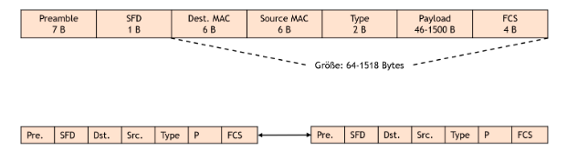

### Kommunikation

- keine Taktleitung
- die Preamble dient mit ihrem 1010...101010 Muster zusammen mit dem SFD mit dem Muster 10101011 zum Erkennen des Takts

